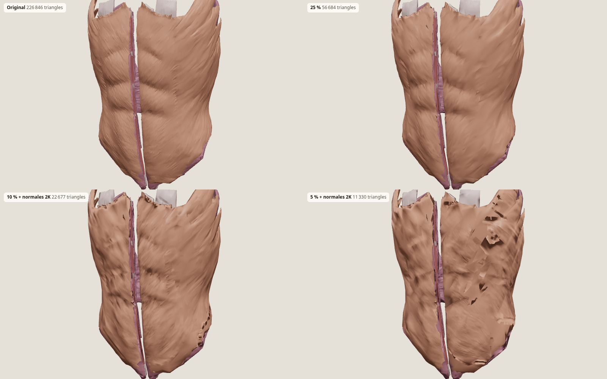
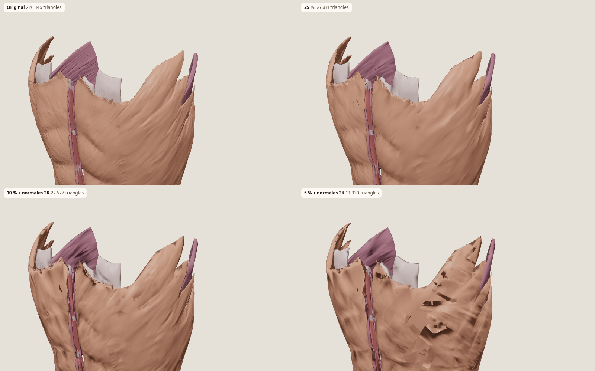

# EXPERIMENT — alléger les muscles Z-Anatomy (paroi abdominale)

Essai isolé. Rien dans `src/`, aucune route, aucun GLB de l’application. Voir aussi [ATTRIBUTION.md](ATTRIBUTION.md).

Comparer ici : `npm install` puis `npm run dev` dans ce dossier, puis http://127.0.0.1:5179/

## Source

Template Blender [Z-Anatomy/Models-of-human-anatomy](https://github.com/Z-Anatomy/Models-of-human-anatomy) (`Z-Anatomy.zip` → `Startup.blend`, 2 mai 2023, 293 Mio). Licence **CC BY-SA 4.0**, dérivé de BodyParts3D **CC BY-SA 2.1 JP**. Blender 4.5.14 LTS, sans interface.

Quatre muscles, gauche et droite. La collection « Rectus sheath » est vide : pas de gaine ni d’aponévrose séparée. Le droit porte une matière Tendon (6 611 / 20 604 faces par côté, les intersections tendineuses). Oblique externe, oblique interne et transverse ont le slot Tendon vide : l’aponévrose est dans le même maillage, même matière.

| Muscle | Triangles (G+D) |
| --- | ---: |
| Droit de l’abdomen | 41 208 |
| Oblique externe | 59 244 |
| Oblique interne | 57 738 |
| Transverse | 68 656 |
| **Total** | **226 846** |

L’export glTF éclatait l’oblique externe (un sommet par coin, normales plates). Une soudure par position (10⁻⁶ m) et des normales lissées ne changent pas le nombre de triangles. Les maillages sont des coques fermées : le bord costal est un pli, pas un bord topologique.

Dans tout le système musculaire du blend : **665** corps, **2 137 447** triangles (marqueurs d’origine et d’insertion exclus). Ces quatre muscles = **10,6 %**.

## Méthode

1. **meshoptimizer** `simplifyWithAttributes` (normales, poids 0,02), drapeaux `LockBorder` + `PreserveFolds`. L’erreur est relevée jusqu’à atteindre 25 %, 10 % et 5 %. Sur le droit, le joint muscle/tendon bloquait le palier bas : second passage sans `LockBorder`, `PreserveFolds` conservé. Erreur finale ≤ 0,008 du rayon du maillage (ordre du millimètre).
2. **Blender Decimate**, collapse, mêmes ratios, sans protection des plis — témoin.
3. **Cartes de normales** tangentes, Cycles, 2048², redimensionnées en 1024², sur les paliers 10 % et 5 %.
4. **Compression** gltf-transform : Draco (edgebreaker, positions 14 bits, normales 10, UV 12) et `EXT_meshopt_compression` (niveau high).

## Tableau

Tailles en Kio (1024 octets). « Brut » = GLB sans extension de compression.

| Variante | Triangles | Brut | Draco | Meshopt | Verdict |
| --- | ---: | ---: | ---: | ---: | --- |
| Original soudé | 226 846 | 3 930 | 665 | 847 | référence |
| meshopt 25 % | 56 684 | 1 062 | 204 | 278 | pas de différence visible |
| meshopt 10 % | 22 693 | 447 | 97 | 127 | bord libre à peine adouci |
| meshopt 5 % | 11 333 | 221 | 52 | 71 | digitations seulement en gros plan |
| 10 % + normales 2K | 22 693 | 11 068 | 10 429 | 10 535 | n’améliore pas le rendu |
| 10 % + normales 1K | 22 693 | 4 433 | 3 795 | 3 900 | idem, toujours trop lourd |
| 5 % + normales 2K | 11 333 | 11 241 | 10 925 | 10 986 | plus loin de l’original que le 5 % nu |
| Decimate 25 % | 56 704 | 1 011 | 200 | 255 | même famille que meshopt |
| Decimate 10 % | 22 676 | 420 | 93 | 117 | écart visuel du même ordre |
| Decimate 5 % | 11 337 | 216 | 52 | 67 | idem |

Écart d’image (Chrome, même caméra, pixels dont la différence dépasse 18/255) contre l’original :

| Vue | 25 % | 10 % | 5 % | 10 % + normales | Decimate 10 % |
| --- | ---: | ---: | ---: | ---: | ---: |
| 3/4 face | 4,1 %* | 7,3 %* | 9,4 %* | 11 %* | 3,8 %** |
| Gros plan marge costale | 2,6 % | 4,6 % | 6,3 % | 6,5 % | 4,7 % |

\*seuil 12/255 sur la vue de face. \*\*seuil 18/255. Le gros plan est le chiffre à retenir : à 25 % on ne voit que le crénelage du contour ; à 10 % le bord libre de l’oblique s’adoucit un peu ; à 5 % les digitations se lisent moins. La carte de normales **éloigne** du modèle d’origine (bake tangent bruité sur le côté miroir, celui dont le déterminant était négatif). La source n’a pas de micro-sculpture à récupérer.

Draco divise la géométrie par environ 4 à 6. Dès qu’une carte PNG est embarquée, elle pèse plus de 95 % du fichier.

## Images

Même lumière, même cadrage. Grille : original, 25 %, 10 % + normales, 5 % + normales.





Gros plan sans carte : [original](screenshots/09-close-original.png), [25 %](screenshots/15-close-25.png), [10 %](screenshots/13-close-10.png), [5 %](screenshots/14-close-05.png), [Decimate 10 %](screenshots/12-close-decimate-10.png).

## FPS

Chrome headless, SwiftShader, 1280×800, **cette VM**. Ce n’est pas un téléphone et pas un GPU.

| Variante | img/s sur 3 s |
| --- | ---: |
| Original | 3 |
| 25 % | 5 |
| 10 % | 7 |
| 5 % | 8 |
| 10 % + normales | 4 |
| Grille des 4 | 1 |

Diviser les triangles par 20 ne multiplie les images que par ~2,5 : le goulot est le remplissage logiciel. Sur un vrai GPU de Chromebook ou de téléphone milieu de gamme, 200 000 triangles de muscles ne sont pas le facteur limitant.

La case « LOD 25 % / 5 % » du viewer bascule selon le zoom (preuve de paire, pas un système de LOD de l’application).

## Recommandation

- **Bureau / Chromebook : 10 %**, un seul maillage, **sans carte de normales**. 23 000 triangles pour la paroi, ~100 Kio en Draco. Le 25 % est le palier « aucune différence » si le cours zoome longtemps sur la marge costale (57 000 triangles, ~200 Kio Draco) — inutile comme défaut.
- **Android milieu de gamme : 10 % aussi.** Le 5 % suffit quand le torse tient dans une petite portion d’écran (LOD lointain). La carte de normales coûte 4 à 11 Mio et dégrade le côté miroir : ne pas l’embarquer.
- meshopt et Decimate se valent à l’œil à 10 %. meshopt est préférable : erreur bornée, plis conservés (`PreserveFolds`).

**Budget corps entier**, même ratio sur les 2,14 millions de triangles musculaires :

| Palier | Triangles muscles | Ordre de grandeur du GLB brut | Après Draco (ratio observé) |
| --- | ---: | ---: | ---: |
| 25 % | ~535 000 | ~10 Mio | ~2 Mio |
| 10 % | ~214 000 | ~4,3 Mio | ~0,9 Mio |
| 5 % | ~107 000 | ~2,1 Mio | ~0,5 Mio |

Le tractus ilio-tibial et les intercostaux sont plus lourds que ces quatre muscles ; mains, face et côtes peuvent rester à 25 % même si le tronc passe à 10 %. Le squelette n’est pas dans ce compte.

## Refaire l’essai

```bash
bash scripts/download_source.sh /tmp/zanatomy
# Blender 4.5 dans le PATH, sous le nom blender
blender --background /tmp/zanatomy/Z-Anatomy/Startup.blend --python scripts/extract_original.py
node scripts/simplify.mjs
blender --background --python scripts/decimate_blender.py
blender --background --python scripts/bake_normals.py -- --size 2048
node scripts/compress.mjs
npm run dev
```

Le `.blend` source n’est pas versionné.
